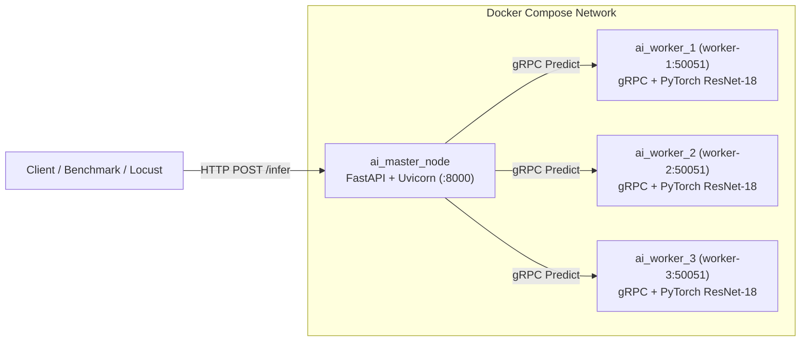
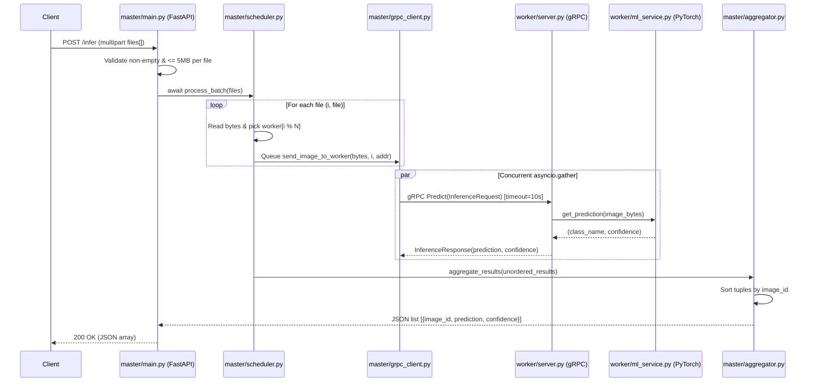
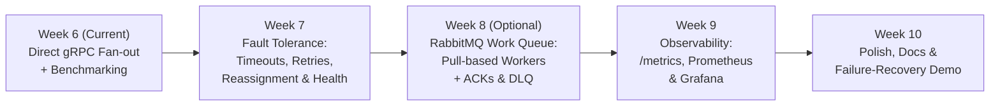

# Project Architecture

**Project:** Distributed AI Model Serving Framework (`distributed-ai-workload`)  
**Documented State:** Week 6 (Multi-Worker Batch Distribution & Benchmarking)  
**Last Updated:** 2026-11-21

This document describes the **currently implemented architecture** in detail, followed by a clearly separated **Planned Evolution** section covering upcoming milestones (Weeks 7–10).

---

## 1. System Overview

The system decouples HTTP request handling from CPU-intensive PyTorch image classification by splitting the application into two containerised roles:

1. **Master Node (`master/`):** A FastAPI ASGI gateway that accepts single or batched image uploads over HTTP, validates payloads, dispatches individual images concurrently to worker nodes over async gRPC, and reassembles predictions in original request order.
2. **Worker Nodes (`worker/`):** Stateless gRPC inference servers running a pretrained PyTorch `ResNet-18` model over ImageNet-1000 labels. Multiple worker replicas run concurrently inside the Docker Compose network.

### High-Level Topology



---

## 2. Request Lifecycle & Sequence

When a client sends a batch of images to `POST /infer`, the master fans out the work concurrently using `asyncio.gather` and round-robin assignment, then sorts responses by their original `image_id`.



---

## 3. Component Responsibilities

### Master Node (`master/`)
| Module | Responsibility |
| :--- | :--- |
| `master/main.py` | FastAPI app entrypoint. Exposes `GET /` (HTML test form), `GET /health`, and `POST /infer`. Enforces file validation (non-empty, max 5 MB per file) and maps exceptions to HTTP 400/413/500 responses. |
| `master/scheduler.py` | Parses `WORKER_ADDRESSES` from the environment, reads uploaded image bytes, assigns each image to a worker using round-robin (`i % NUM_OF_WORKERS`), runs all gRPC coroutines concurrently via `asyncio.gather`, and passes results to the aggregator. |
| `master/grpc_client.py` | Async gRPC client (`grpc.aio.insecure_channel`) that serializes `image_bytes` into `InferenceRequest`, invokes `InferenceServiceStub.Predict` with a `10.0s` timeout, and returns `(prediction, confidence, image_id)`. |
| `master/aggregator.py` | Sorts the unordered `(prediction, confidence, image_id)` tuples by `image_id` and formats the final JSON response array. |

### Worker Node (`worker/`)
| Module | Responsibility |
| :--- | :--- |
| `worker/server.py` | Hosts `InferenceServiceServicer` on `[::]:50051` backed by `concurrent.futures.ThreadPoolExecutor(max_workers=10)`. Extracts image bytes, invokes `get_prediction`, and catches inference errors into `grpc.StatusCode.INTERNAL`. |
| `worker/ml_service.py` | Loads pretrained `torchvision.models.resnet18(weights='DEFAULT')` in `eval()` mode once at startup along with `/app/data/labels/imagenet-labels.json`. Decodes bytes via PIL (RGB), applies ImageNet normalization (`Resize(256) -> CenterCrop(224) -> ToTensor -> Normalize`), runs `torch.no_grad()` forward pass, and returns the top-1 class label and softmax confidence. |

### Scripts (`scripts/`)
| Script | Responsibility |
| :--- | :--- |
| `scripts/infer_local.py` | Week 1 standalone local inference script. |
| `scripts/benchmark.py` | Sends 5 consecutive batches of 200 images via `httpx.AsyncClient` to `POST /infer` and reports total latency and throughput (images/sec). |
| `scripts/locust.py` | Locust `HttpUser` (`PhotoUploadUser`) simulating concurrent clients uploading test images to `/infer` with `between(1, 5)` wait time. |

---

## 4. API & gRPC Data Contracts

### External HTTP API (Master `:8000`)

| Endpoint | Method | Request | Response | Notes |
| :--- | :--- | :--- | :--- | :--- |
| `/` | `GET` | — | `text/html` | Minimal multi-file upload form for manual testing. |
| `/health` | `GET` | — | `200 OK` JSON | Returns `{"status": "healthy", "active_workers": 0, "system_load": "normal"}` (static placeholder). |
| `/infer` | `POST` | `multipart/form-data` (`files`: one or more image files) | `200 OK` JSON array | Returns ordered list of predictions. Errors: `400` (empty file), `413` (>5 MB), `500` (worker/gRPC failure). |

**`POST /infer` Response Schema:**
```json
[
  {
    "image_id": 0,
    "prediction": "African elephant",
    "confidence": 0.8742
  }
]
```

### Internal gRPC Contract (`proto/inference.proto`)

```protobuf
syntax = "proto3";

package inference;

service InferenceService {
    rpc Predict (InferenceRequest) returns (InferenceResponse);
}

message InferenceRequest {
    bytes image_data = 1;
}

message InferenceResponse {
    string prediction = 1;
    float confidence = 2;
}
```

- **Transport:** Plaintext HTTP/2 (`insecure_channel`) inside the private Docker Compose bridge network.
- **Granularity:** One unary RPC per image (the master fans out per-image RPCs concurrently rather than sending a multi-image protobuf batch).
- **Timeout:** `10.0` seconds per RPC on the master client.

---

## 5. Deployment & Networking Topology

Orchestrated locally via `docker-compose.yml` using two dedicated images built on `python:3-slim` with `uv` (`uv sync --frozen --no-dev`) and non-root execution (`appuser`).

| Service | Container Name | Dockerfile | Ports | Environment Variables | Runtime Command |
| :--- | :--- | :--- | :--- | :--- | :--- |
| `master` | `ai_master_node` | `DockerFile.master` | `8000:8000` (published) | `WORKER_ADDRESSES=worker-1:50051 ,worker-2:50051 ,worker-3:50051`<br>`ENV=development` | `uvicorn master.main:app --host 0.0.0.0 --port 8000` |
| `worker-1` | `ai_worker_1` | `DockerFile.worker` | `50051` (internal `expose`) | `ENV=development`<br>`TORCH_HOME=/app/.cache/torch` | `python worker/server.py` |
| `worker-2` | `ai_worker_2` | `DockerFile.worker` | `50051` (internal `expose`) | `ENV=development`<br>`TORCH_HOME=/app/.cache/torch` | `python worker/server.py` |
| `worker-3` | `ai_worker_3` | `DockerFile.worker` | `50051` (internal `expose`) | `ENV=development`<br>`TORCH_HOME=/app/.cache/torch` | `python worker/server.py` |

### Key Container Details
- **Network Isolation:** Only the master's port `8000` is published to the host. Workers expose `50051` strictly inside Docker's internal DNS network (`worker-1`, `worker-2`, `worker-3`).
- **Startup Ordering:** `master` declares `depends_on: [worker-1, worker-2, worker-3]` (container start order only; no readiness healthcheck yet).
- **Security & Caching:** Containers run as non-root `appuser` (`UID 10002` on master, `UID 10001` on worker). `DockerFile.worker` pre-creates `/app/.cache/torch` owned by `appuser` so ResNet-18 weights can be cached without root permissions.
- **Dependency Installation:** Both images copy `pyproject.toml` and `uv.lock`, sync into `/app/.venv`, and prepend `/app/.venv/bin` to `PATH`.

---

## 6. Lightweight Architecture Decision Records (ADRs)

### ADR-001: FastAPI for the Master Gateway
- **Decision:** Use FastAPI + Uvicorn as the public HTTP entrypoint.
- **Rationale:** Native `async`/`await` support pairs cleanly with `asyncio.gather` and `grpc.aio`, allowing the master to handle concurrent I/O-bound gRPC fan-out without blocking worker threads. Built-in `UploadFile` handling and automatic OpenAPI docs accelerate development.

### ADR-002: gRPC + Protocol Buffers for Master-to-Worker Communication
- **Decision:** Communicate between master and workers via gRPC over HTTP/2 rather than internal REST/JSON.
- **Rationale:** Binary protobuf payloads avoid base64-encoding overhead for raw image `bytes`, HTTP/2 multiplexes concurrent requests efficiently, and `.proto` files enforce a strict service contract between master and worker processes.

### ADR-003: Pretrained PyTorch ResNet-18 on CPU
- **Decision:** Serve `torchvision.models.resnet18(weights='DEFAULT')` loaded once at worker startup.
- **Rationale:** ResNet-18 is lightweight enough to run multiple worker replicas on a local machine while still being compute-heavy enough to demonstrate real distributed speedup (and local CPU contention plateau between 2 and 3 workers, as observed in Week 6 benchmarks).

### ADR-004: `uv` (`pyproject.toml` + `uv.lock`) for Dependency Management
- **Decision:** Replace `pip` + `requirements.txt` with `uv`, `pyproject.toml`, and `uv.lock`.
- **Rationale:** Provides deterministic cross-environment lockfiles (`uv sync --frozen --no-dev`), significantly faster Docker builds, and clean separation of runtime vs. development dependencies.

---

## 7. Planned Evolution (Weeks 7–10)

> **Note:** The components below are **not yet implemented**. They represent the planned roadmap in `context.md` and must not be assumed to exist in the current codebase.



- **Week 7 — Worker Failure Handling (Next Milestone):**
  - Detect worker crashes/timeouts mid-batch, mark unhealthy workers, and retry/reassign failed items to healthy workers.
  - Upgrade `GET /health` to reflect real active worker status and optional heartbeat checks.
- **Week 8 — Queue-Based Scheduling (Optional):**
  - Replace direct master-push gRPC fan-out with a RabbitMQ work queue (`producer` in master, `consumer` in workers, prefetch limits, message ACKs, and dead-letter queues).
- **Week 9 — Metrics & Observability:**
  - Expose `/metrics` (request count, latency histograms, inference latency, worker success/failure/retry counts, active workers) scraped by Prometheus and visualized in Grafana.
- **Week 10 — Final Polish & Demo:**
  - End-to-end demo scripts covering single-image, multi-worker batching, scaling comparison, mid-job worker kill + recovery, and observability dashboards.
